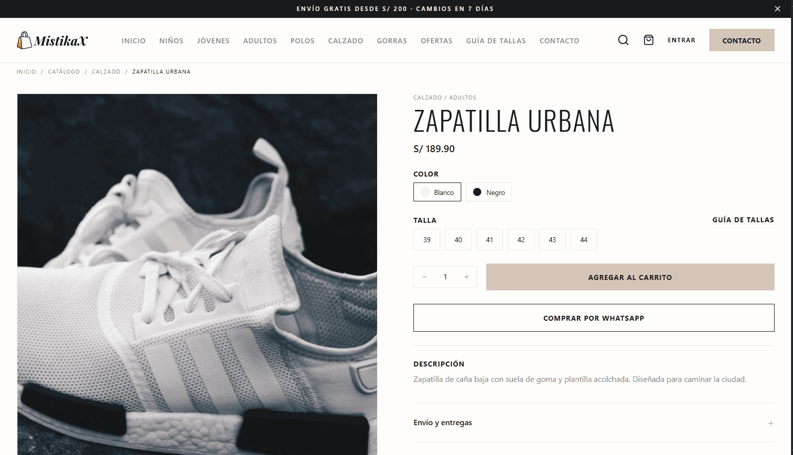

<div align="center">
<picture>
  <source
    media="(prefers-color-scheme: dark)"
    srcset="./public/svg/logo-full.svg"
    width="48%"
  />

  
</picture>

  <p><strong>Menswear, footwear, and accessories for every age.</strong><br />A full-stack storefront and operations dashboard for a Peruvian retailer.</p>

  <p>
    <a href="https://nextjs.org"></a>
    <a href="https://react.dev"></a>
    <a href="https://www.typescriptlang.org"></a>
    <a href="https://tailwindcss.com"></a>
    <a href="https://supabase.com"></a>
    <a href="https://orm.drizzle.team"></a>
    <a href="https://pnpm.io"></a>
  </p>
</div>

<div align="center">
  
</div>

## What is Mistikax?

Mistikax is a Spanish-language shopping experience and admin workspace for a menswear store in Peru. Customers can browse products, choose sizes, manage a cart, and place orders. Store staff can manage the catalog, inventory, orders, content, promotions, and store settings from one dashboard.

The project is built as a single Next.js App Router application. Its original HTML prototypes remain design references; production behavior lives in typed React components, feature modules, server actions, and database queries.

## Highlights

| Storefront | Admin workspace |
| --- | --- |
| Product catalog with search, filters, sorting, and pagination | Sales overview with order and inventory indicators |
| Product detail, size selection, and related products | Product, category, and size-level inventory management |
| Cart, shipping selection, checkout, and order confirmation | Order search, status history, notes, and guarded transitions |
| Customer accounts with email and Google sign-in | Customer, coupon, and store settings management |
| FAQs, size guide, and editable informational pages | Home-page content, FAQs, and published page editors |

Orders use transactional status changes, and cancelling an order restores its stock only once. Prices are stored as integer cents and presented in Peruvian soles (PEN).

## Routes

| Area | Routes |
| --- | --- |
| Store | `/`, `/catalog`, `/product/[id]`, `/cart`, `/checkout`, `/checkout/success` |
| Customer account | `/account/sign-in`, `/account/sign-up`, `/account` |
| Store information | `/pages/[slug]`, `/faq`, `/shipping`, `/size-guide` |
| Admin | `/admin`, `/admin/products`, `/admin/categories`, `/admin/inventory` |
| Sales | `/admin/orders`, `/admin/customers`, `/admin/coupons` |
| Content and settings | `/admin/content/home`, `/admin/content/pages`, `/admin/content/faqs`, `/admin/media`, `/admin/settings` |
| Authentication | `/login`, `/auth/callback` |

Admin access is role-based (`admin` and `editor`) and enforced on the server. Customer accounts are separate from staff access.

## Stack

- **Application:** Next.js 16 App Router, React 19, TypeScript 5 (strict)
- **UI:** Tailwind CSS v4, shadcn/ui, Radix UI, Iconify
- **Data:** Supabase Postgres with Drizzle ORM and `postgres.js`
- **Authentication:** Supabase Auth with `@supabase/ssr`
- **Validation and forms:** Zod, React Hook Form
- **Feedback and charts:** Sonner, Recharts
- **Tests:** Vitest

## Get started

### Requirements

- Node.js 24
- pnpm 11
- A Supabase project for Postgres and Auth

### Install and configure

```bash
pnpm install
cp .env.example .env
```

On PowerShell, use `Copy-Item .env.example .env` instead of `cp`.

Fill in the values in `.env` for the database connections, Supabase URL and publishable key, server-only Supabase secret, cart-cookie secret, and local site URL. Use the pooled connection for runtime queries and the direct connection for migrations. Never expose server secrets through a `NEXT_PUBLIC_` variable or commit `.env`.

Configure the Supabase Auth redirect URLs to include:

- `http://localhost:3000/auth/callback`
- `https://<your-domain>/auth/callback`

Apply the database migrations and optionally load the development seed:

```bash
pnpm db:migrate
pnpm db:seed
```

Start the development server:

```bash
pnpm dev
```

Open [http://localhost:3000](http://localhost:3000).

## Useful commands

| Command | Purpose |
| --- | --- |
| `pnpm dev` | Run the development server |
| `pnpm build` | Create a production build |
| `pnpm start` | Serve the production build |
| `pnpm lint` | Run ESLint |
| `pnpm typecheck` | Check TypeScript without emitting files |
| `pnpm test` | Run Vitest |
| `pnpm db:generate` | Generate Drizzle migrations |
| `pnpm db:migrate` | Apply migrations to the configured database |
| `pnpm db:seed` | Seed catalog, orders, coupons, content, and settings |

## Project layout

```text
src/
├── app/          # Route groups, layouts, metadata, and page composition
├── components/   # Shared, admin, store, and shadcn/ui components
├── features/     # Domain queries, actions, schemas, and components
├── db/           # Drizzle client, schema, and seed
└── lib/            # Shared utilities and environment validation
drizzle/          # SQL migrations
public/images/    # Committed product and content images
public/svg/       # Brand assets
storage/uploads/  # Local runtime uploads; keep outside version control
```

The application is server-first: pages load initial data on the server, and domain logic stays in `src/features/<domain>`. Mutations are validated at the boundary and protected server-side.

## Runtime notes

- Store fonts load through CSS imports in `src/app/globals.css`; keep this approach for reliable Turbopack builds.
- Keep the database pool above one connection, close idle connections after 60 seconds, and use `prepare: false` with the Supabase pooler so concurrent storefront queries are not serialized or retained indefinitely.
- Runtime uploads use the configured local directory outside `public`. Production hosting must provide persistent writable storage; ephemeral serverless filesystems are not supported.

## Project status

The storefront and admin feature set is implemented. The remaining roadmap is focused on final validation, accessibility and launch readiness. See [plan.md](./plan.md) for phase details and architecture decisions.

## Documentation

- [Migration plan and architecture](./plan.md)
- [Project conventions and security rules](./CLAUDE.md)
